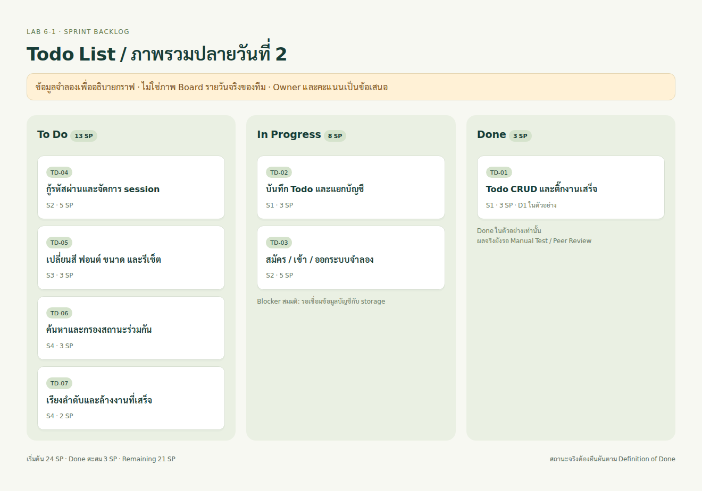
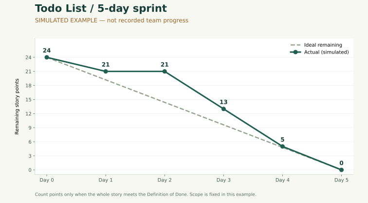

# Lab 6-1 — Burndown Chart ของ Todo List

## 1. Sprint Goal และวิธีนับ

เป้าหมาย: ผู้ใช้จัดการ Todo ของตัวเองได้ตั้งแต่เพิ่ม แก้ไข ลบ ติ๊กเสร็จ ค้นหา และกลับมาเปิดดูข้อมูลเดิมได้

ตัวอย่าง Sprint 5 วัน รวม 24 Story Points เริ่ม D0 = 24 คะแนน นับคะแนนทั้ง Story เป็น Done เมื่อผ่านเกณฑ์ ไม่ลดคะแนนครึ่งหนึ่งเพราะเขียนโค้ดไปแล้วครึ่งหนึ่ง สูตร `Remaining = คะแนนเริ่มต้น − ผลรวมคะแนน Story ที่ Done สะสม` และ `Ideal วันที่ d = 24 × (1 − d/5)` ขอบเขตในตัวอย่างคงที่ หากเพิ่มงานระหว่าง Sprint ต้องบันทึก scope change แยก ไม่แก้ประวัติเก่าให้ดูดี

## 2. Sprint Backlog ตัวอย่าง

S1–S4 เป็นตำแหน่งงานที่เสนอให้ทีมแบ่ง ต้องแทนด้วยชื่อจริงและให้ทีมยืนยันคะแนน

| ID | งาน | Owner เสนอ | SP | สถานะปลาย D2 จำลอง | วัน Done จำลอง |
|---|---|---|---:|---|---|
| TD-01 | เพิ่ม/แก้ไข/ลบ/ติ๊ก Todo พร้อมตรวจข้อความว่าง | S1 | 3 | Done | D1 |
| TD-02 | บันทึก Todo และแยกข้อมูลแต่ละบัญชี | S1 | 3 | In Progress | D3 |
| TD-03 | สมัคร/เข้า/ออกระบบสมาชิกจำลอง | S2 | 5 | In Progress | D3 |
| TD-04 | กู้รหัสผ่านด้วยรหัสกู้คืนและจัดการ session | S2 | 5 | To Do | D4 |
| TD-05 | เปลี่ยนสี ฟอนต์ ขนาด และรีเซ็ต | S3 | 3 | To Do | D4 |
| TD-06 | ค้นหาและกรองสถานะ Todo ร่วมกัน | S4 | 3 | To Do | D5 |
| TD-07 | เรียงลำดับและล้างงานเสร็จพร้อมยืนยัน | S4 | 2 | To Do | D5 |
| **รวม** | | | **24** | | |

Definition of Done สำหรับทีม: ตรงเกณฑ์รับงาน → ใช้งานได้จริง → automated tests ผ่าน → นักศึกษาทดสอบเองและไม่มีข้อผิดพลาดสำคัญ → เพื่อนตรวจ → โค้ดอยู่ใน Git และพร้อม Demo สถานะข้างบนเป็นตัวอย่างเพื่อคำนวณเท่านั้น สถานะงานจริงดู Lab 6-2

## 3. ตาราง Burndown

| วัน | Ideal Remaining | Actual จำลอง | Story ที่ปิดในวันนั้น (จำลอง) | เหตุการณ์ตัวอย่าง |
|---|---:|---:|---|---|
| D0 | 24 | 24 | — | เริ่ม Sprint |
| D1 | 19.2 | 21 | TD-01 = 3 | CRUD ผ่านเกณฑ์ |
| D2 | 14.4 | 21 | — | รอเชื่อมการสลับบัญชีกับ storage |
| D3 | 9.6 | 13 | TD-02 + TD-03 = 8 | ทดสอบข้อมูลแยกบัญชีผ่าน |
| D4 | 4.8 | 5 | TD-04 + TD-05 = 8 | กู้รหัสผ่านและธีมพร้อม Demo |
| D5 | 0 | 0 | TD-06 + TD-07 = 5 | ตรวจค้นหา/กรอง/เรียง/ล้างงานครบ |

แกน X = วันของ Sprint, แกน Y = Story Points ที่เหลือ เส้น Ideal คือแผน ส่วน Actual ในภาพนี้คือ **สถานการณ์สมมติ** ดาวน์โหลดค่าจาก [todo-simulation.csv](data/todo-simulation.csv)

## 4. วิเคราะห์กราฟ 8 บรรทัด — ใช้อธิบายตัวอย่างนี้

1. ตัวอย่างนี้เริ่มด้วยงาน 24 คะแนน และกำหนดเวลา 5 วัน
2. ช่วง D1–D4 เส้น Actual อยู่สูงกว่า Ideal แปลว่างานเหลือมากกว่าแผน
3. D2 ล่าช้าจากแผนมากที่สุด 6.6 คะแนน เพราะ Ideal เหลือ 14.4 แต่ Actual ยังเหลือ 21
4. หากถามจำนวนงานค้างสูงสุด คือ D0 ที่ 24 คะแนน; หลังเริ่มทำงาน D1 และ D2 เหลือสูงสุดเท่ากันที่ 21 คะแนน
5. ช่วง D1→D2 กราฟไม่ลดลง เพราะยังไม่มี Story ใหม่ผ่านเกณฑ์ Done ไม่ได้แปลว่าทีมไม่ได้ทำงานเลย
6. สาเหตุที่กำหนดในสถานการณ์นี้คือรอเชื่อมข้อมูลระหว่างระบบสมาชิกและ Todo ซึ่งกราฟอย่างเดียวพิสูจน์สาเหตุไม่ได้
7. D5 เหลือ 0 คะแนนและปิดได้ในสถานการณ์จำลอง แต่มีงาน 5 คะแนนมาปิดวันท้าย จึงยังมีความเสี่ยงถ้าพบ bug ช้า
8. Sprint ถัดไปควรแบ่ง task ให้เล็ก มีเกณฑ์รับงานก่อนเริ่ม และตรวจ integration ระหว่างทางเพื่อลดการรอช่วงท้าย

หากกราฟจริงปิดทุกอย่างเฉพาะวันสุดท้าย อย่าสรุปว่าทำงานดีเพราะจบที่ศูนย์ อาจเกิดจากอัปเดต Board ช้า, Story ใหญ่ หรือทดสอบรวมช้า ต้องถามทีมและตรวจหลักฐาน

## 5. ปัญหาที่ทราบจริงกับสมมติฐาน

| ประเภท | ปัญหา | แนวทาง |
|---|---|---|
| ทราบจากงานก่อนหน้า | เคยติดสิทธิ์เขียน GitHub และข้อจำกัดการเรียกใช้งาน ก่อนเผยแพร่สำเร็จ | ตรวจสิทธิ์และส่ง commit เล็กตั้งแต่ต้น |
| ทราบจากงานก่อนหน้า | ฟอนต์ไทยต้องโหลดได้ในสภาพแวดล้อมทดสอบ | เก็บฟอนต์ในโปรเจกต์และตรวจหน้าจอจริง |
| ยังขาดหลักฐาน | ไม่มีสถานะรายวันของทีม/Manual Test/Peer Review | เก็บแบบฟอร์มจริงก่อนยืนยัน Done |
| สมมติในกราฟ | D2 รอ integration ของระบบสมาชิกกับ storage | ให้ทีมตรวจว่าตรงกับเหตุการณ์จริงหรือไม่ |

## 6. เปลี่ยนเป็นข้อมูลจริงก่อนส่ง

กรอก [todo-actual-template.csv](data/todo-actual-template.csv) ด้วยวันที่จริงและคะแนนคงเหลือ ณ เวลาที่ตกลงกัน ห้ามเติมวันที่ย้อนหลังจากการคาดเดา ถ้าไม่มีข้อมูลย้อนหลัง ให้แจ้งอาจารย์ว่ามีเฉพาะตัวอย่างจำลองและเริ่มเก็บใน Sprint ถัดไป สร้างกราฟจากคอลัมน์ Day / Ideal / Actual และแนบภาพ Board ของทีมจริง พร้อมผู้บันทึกและเวลาบันทึก
