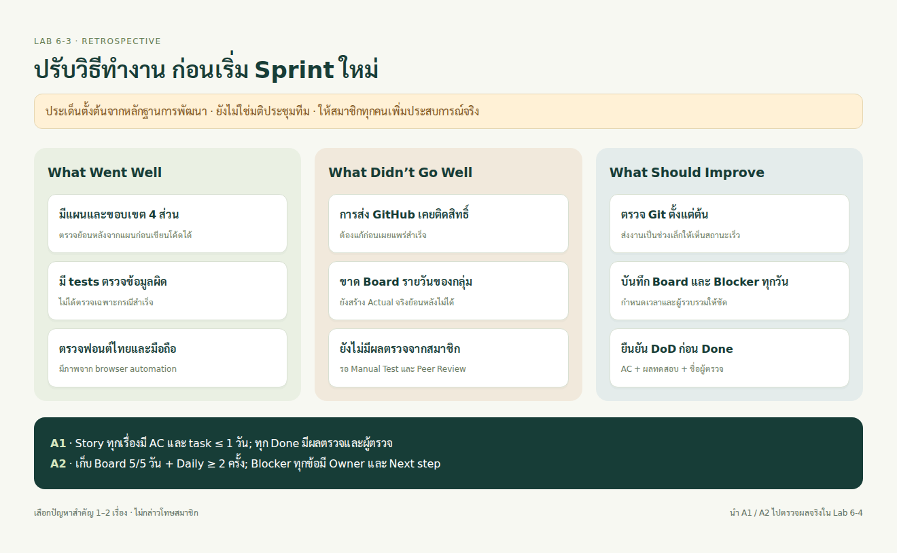

# Lab 6-3 — Sprint Retrospective

## 1. Retrospective Board ตั้งต้น

ประเด็นด้านล่างสรุปจากการพัฒนาที่มีหลักฐานและช่องว่างที่พบ ยังไม่ใช่มติจากการประชุมของสมาชิก ให้แต่ละคนเพิ่มประสบการณ์จริง แล้วร่วมกันเลือกปัญหาสำคัญ 1–2 เรื่อง

| What Went Well — สิ่งที่ดี | What Didn’t Go Well — ปัญหา | What Should We Improve — สิ่งที่จะปรับ |
|---|---|---|
| มีแผนก่อนลงมือ และแยกขอบเขตงาน 4 ส่วน | การส่งขึ้น GitHub ช่วงแรกติดสิทธิ์/ข้อจำกัดการเรียกใช้งาน | ตรวจการเข้าถึง Git และส่ง commit เล็กตั้งแต่เริ่ม |
| มี tests ตรวจทั้งกรณีปกติและข้อมูลผิด | ยังไม่มีบันทึก Board รายวันของสมาชิกให้สร้าง Actual จริง | บันทึกสถานะและ Blocker ทุกวันพร้อมเวลา |
| ปรับฟอนต์และตรวจหน้าจอมือถือได้ | โค้ดที่พร้อม Demo ยังไม่มีผล Manual Test/Peer Review จากทีม | กำหนด DoD และเก็บหลักฐานก่อนเปลี่ยนเป็น Done |

## 2. Action Items ที่เลือกเสนอให้ทีม

| ID | สิ่งที่จะทำ | Owner เสนอ | เวลา/กำหนด | วิธีวัดผล | หลักฐาน |
|---|---|---|---|---|---|
| A1 | ทุก Story มี Acceptance Criteria และแตก task ขนาดไม่เกิน 1 วันก่อนเริ่ม; จับคู่ตรวจฟีเจอร์ก่อน Done | S1 ดูแล; ทุกคนรับผิดชอบงานตน | ก่อนเริ่มแต่ละ Story และก่อนปิดการ์ด | 100% ของ Story ใน Sprint มี AC; 100% ของ Done มีผลทดสอบและชื่อผู้ตรวจ | Sprint Backlog, checklist, PR/ผลตรวจ |
| A2 | อัปเดต Board และ Remaining ทุกวันในเวลาที่ทีมตกลง; แจ้ง Blocker พร้อมเจ้าของเรื่อง | S4 รวบรวม; ทุกคนอัปเดต | เสนอ 20:00 น. เวลาไทยของทุกวัน Sprint | มี snapshot 5/5 วัน; Daily อย่างน้อย 2 ครั้ง; Blocker ทุกข้อมี owner และ next step | ภาพ Board, CSV, Daily log |

นี่คือข้อเสนอที่วัดผลได้ ให้ทีมลงชื่อรับผิดชอบจริงใน TEAM-EVIDENCE ก่อนใช้ หากสมาชิกไม่สะดวก 20:00 น. ให้ตกลงเวลาใหม่ก่อน Sprint ไม่ต้องอ้างว่ามีการอัปเดตครบแล้ว

## 3. สมาชิกแต่ละคนเตรียมพูด

| สมาชิก | ประเด็นเตรียมคุย | สิ่งที่ต้องเติมจากประสบการณ์จริง |
|---|---|---|
| S1 | ขอบเขตงานและการแบ่ง task | งานไหนใหญ่เกินไป/เชื่อมกับส่วนอื่นอย่างไร |
| S2 | การเชื่อมระบบและ Blocker | พบอุปสรรคอะไร แก้หรือขอความช่วยเหลืออย่างไร |
| S3 | การตรวจหน้าจอและความเข้าใจของผู้ใช้ | พบปัญหาการใช้งานจริงจุดไหน |
| S4 | การทดสอบและการเก็บสถานะงาน | มีหลักฐานอะไรขาด และจะเก็บให้ครบอย่างไร |

## 4. Reflection ตั้งต้น

“สิ่งที่อยากปรับใน Sprint ถัดไปคือทำให้เห็นสถานะงานจากหลักฐานมากขึ้น ไม่รอให้เขียนโค้ดเสร็จแล้วค่อยตรวจทุกอย่าง เราจะกำหนดเกณฑ์รับงานก่อนเริ่มและเก็บผลตรวจของแต่ละ Story ส่วน Board จะอัปเดตทุกวัน เพื่อให้กราฟ Burndown บอกความคืบหน้าได้จริง”

หลังประชุม ให้บันทึกเรื่องที่แต่ละคนพูด เหตุผลที่เลือก A1/A2 และวันตรวจผลใน Sprint ถัดไป ไม่มีการกล่าวโทษรายบุคคล และอย่าเขียนว่าทีมเห็นด้วยแล้วจนกว่าจะคุยกันจริง
