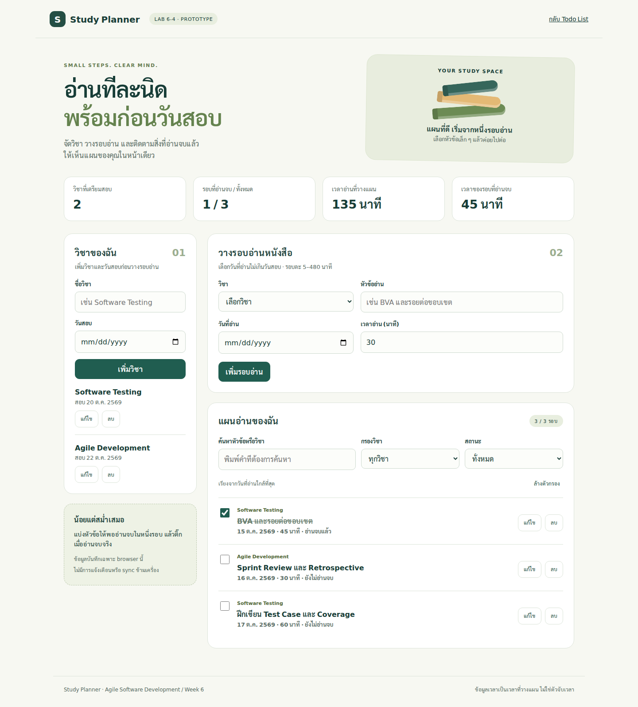
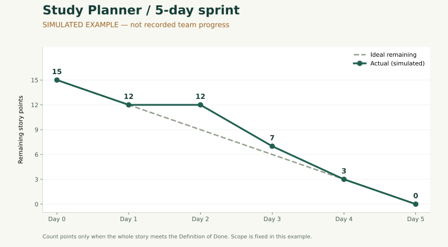

# Lab 6-4 — Study Planner: วางแผนอ่านหนังสือก่อนสอบ

อ้างอิงโจทย์หน้า 168–174 | วิดีโอ 10–15 นาที | โจทย์ใหม่ที่ผู้ใช้เลือก

## 1. Product Goal และขอบเขต

ช่วยให้นักศึกษาจัดตารางอ่านหนังสือแยกตามวิชาและวันสอบ แล้วเห็นว่ารอบใดอ่านจบแล้ว เพื่อเตรียมตัวก่อนสอบได้เป็นระบบ

ผู้ใช้หลักคือนักศึกษาที่มีหลายวิชาต้องเตรียมพร้อมกัน ต้นแบบนี้เป็น **Study Planner คนละโจทย์กับ Todo List** มีโครงสร้าง `วิชา → วันสอบ → รอบอ่าน → เวลาอ่าน → ความคืบหน้า` และกฎว่ารอบอ่านต้องไม่เกินวันสอบ เก็บ source ใน repository เดิมเพื่อให้ส่งงานรวมได้

ต้นแบบอยู่ใน [public/study-planner](../../public/study-planner/) ใช้ HTML/CSS/JavaScript modules และเปิดผ่าน Vite เดิมที่ `/study-planner/` ข้อมูลอยู่ใน browser เครื่องนั้น ยังไม่มีบัญชี, backend, sync, การแจ้งเตือน หรือตัวจับเวลาที่วัดเวลาจริง

## 2. Product Backlog — 8 User Stories

คะแนนและ Priority เป็น **ข้อเสนอสำหรับทีมร่วม Estimate** ไม่ใช่คะแนนที่สมาชิกได้โหวตแล้ว

| ID | User Story | Priority | SP | Sprint นี้ |
|---|---|---|---:|---|
| SP-01 | ในฐานะนักศึกษา ฉันต้องการเพิ่ม/แก้ไขวิชาและวันสอบ เพื่อรู้ว่าต้องเตรียมวิชาใดก่อน | Must | 3 | เลือก |
| SP-02 | ในฐานะนักศึกษา ฉันต้องการเพิ่ม/แก้ไข/ลบรอบอ่านพร้อมหัวข้อ วันที่ และเวลา เพื่อแบ่งการอ่านเป็นช่วงเล็ก ๆ | Must | 5 | เลือก |
| SP-03 | ในฐานะนักศึกษา ฉันต้องการติ๊กอ่านจบและดูยอดรวม เพื่อเห็นความคืบหน้าของแผน | Must | 2 | เลือก |
| SP-04 | ในฐานะนักศึกษา ฉันต้องการค้นหา/กรองวิชาและสถานะ พร้อมเรียงวันที่ เพื่อเลือกรอบอ่านที่ต้องทำ | Should | 2 | เลือก |
| SP-05 | ในฐานะนักศึกษา ฉันต้องการเปิดแผนเดิมหลังรีเฟรช เพื่อไม่ต้องกรอกข้อมูลใหม่ | Must | 3 | เลือก |
| SP-06 | ในฐานะนักศึกษา ฉันต้องการส่งออกและนำเข้าแผน เพื่อสำรองข้อมูล | Should | 3 | Future |
| SP-07 | ในฐานะนักศึกษา ฉันต้องการระบบแจ้งเตือนก่อนอ่าน เพื่อไม่ลืมตามแผน | Could | 5 | Future |
| SP-08 | ในฐานะนักศึกษา ฉันต้องการดูแผนแบบปฏิทิน เพื่อเห็นวันว่างและวันแน่น | Could | 5 | Future |

รวม Product Backlog 28 SP; เลือก 15 SP เข้า Sprint ห้ามนำ 28 ไปเป็นจุดเริ่ม Burndown ของ Sprint นี้ และไม่เทียบว่า 15 น้อยกว่า Todo 24 แล้วทีมช้าลง เพราะเป็นคนละขอบเขตและยังไม่ใช่ Velocity จริง

## 3. Sprint Planning — 5 วัน

**Sprint Goal:** นักศึกษาวางแผนอ่านอย่างน้อย 2 วิชา ติดตามรอบที่อ่านจบ และกลับมาเปิดแผนเดิมใน browser ได้

ทีม 4 คน / ประมาณ 2 ชั่วโมงต่อคนต่อวัน × 5 วัน = 40 ชั่วโมง เป็น **สมมติฐานสำหรับวางแผน** ให้ทีมยืนยันเวลาว่างจริงก่อนเลือกงาน ไม่แปลง Story Point เป็นชั่วโมงแบบตายตัว แบ่งเวลาเป็นพัฒนา 24 ชั่วโมง ทดสอบ/Review/ปรับแก้ 10 ชั่วโมง และประชุม/หลักฐาน 6 ชั่วโมง หากเวลาจริงน้อยลงให้ลด SP-04 ก่อนโดยยังรักษา Goal

บทบาทเสนอ: S1 ประสาน Product Goal/Backlog และเป็น Developer; S4 ดูแลเวลา/Board และเป็น Developer; S2–S3 เป็น Developers ทุกคนร่วม Estimate, Daily, Review และ Retro ผู้ให้ feedback ควรเป็นเพื่อนนอกกลุ่มหรืออาจารย์

| Story | Owner เสนอ | Tasks ขนาดไม่เกิน 1 วัน (เวลาวางแผน) | AC หลัก | สถานะโค้ด / สถานะทีม |
|---|---|---|---|---|
| SP-01 / 3 SP | S1 | ฟอร์มวิชา 2 ชม.; ตรวจข้อมูล/แก้ไข/ลบ 2 ชม. | ชื่อไม่ว่างหรือซ้ำ; วันสอบถูกต้อง; ป้องกันลบวิชาที่มีรอบอ่าน | พร้อม Demo / รอทีมตรวจ |
| SP-02 / 5 SP | S2 | ฟอร์มรอบอ่าน 3 ชม.; CRUD 3 ชม.; กฎวันที่/เวลา 2 ชม. | ต้องมีวิชา; หัวข้อ 1–120 ตัว; 5–480 นาทีจำนวนเต็ม; วันที่ไม่เกินสอบ | พร้อม Demo / รอทีมตรวจ |
| SP-03 / 2 SP | S3 | Complete 1 ชม.; summary 2 ชม. | ติ๊กกลับได้; จำนวนและนาทีเปลี่ยนถูก; แก้ไขไม่ล้างสถานะอ่านจบ | พร้อม Demo / รอทีมตรวจ |
| SP-04 / 2 SP | S3 | filter/search 2 ชม.; responsive 2 ชม. | เงื่อนไขทำงานร่วมกัน; เรียงวันที่; มี empty state; ไม่มีล้นที่ 320px | พร้อม Demo / รอทีมตรวจ |
| SP-05 / 3 SP | S4 | persistence 2 ชม.; corrupt/blocked storage 3 ชม. | refresh แล้วยังอยู่; ข้อมูลเสียไม่ถูกเขียนทับเงียบ ๆ; บันทึกไม่ได้มีข้อความ | พร้อม Demo / รอทีมตรวจ |

รวม task พัฒนา 24 ชั่วโมงเป็นการแบ่งงานที่เสนอ ไม่ใช่เวลาที่จับจากการทำจริง สถานะ Board เริ่มต้นของทีมใช้ To Do → In Progress → Done โดยให้เปลี่ยนตามผลทำงานจริง

**Definition of Done:** AC ผ่านครบ, unit tests และ build ผ่าน, ทดสอบบน browser/มือถือ, นักศึกษาทำ Manual Test, เพื่อนตรวจ, ไม่มีข้อผิดพลาดสำคัญ, source อยู่ใน Git และทีม Demo ได้ โค้ดพร้อมทดสอบยังไม่เท่ากับ Done ของทีม

## 4. Development และ Daily Scrum

มีแผนก่อนเขียนโค้ดและ Git commits ของการพัฒนาจริงจาก Codex พร้อม tests หลังโค้ดหลัก ดู [IMPLEMENTATION-PLAN.md](IMPLEMENTATION-PLAN.md), `git log --oneline origin/feature4.1..lab6` และ [VALIDATION.md](VALIDATION.md) ไม่มีการอ้างว่าสมาชิก 4 คนเขียน commits เหล่านี้เอง

จำลอง Daily **อย่างน้อย 2 ครั้ง** โดยแต่ละครั้งไม่เกิน 15 นาที ใช้หัวข้อ Yesterday / Today / Blocker ของทุกคน ตัวอย่างเตรียมซ้อม:

| ครั้ง | คน | Yesterday ตัวอย่าง | Today ตัวอย่าง | Blocker ตัวอย่าง |
|---|---|---|---|---|
| 1 — D2 | S1 | วางฟอร์มวิชาและวันสอบ | ตรวจชื่อซ้ำและการแก้วันสอบ | ต้องตกลงกฎเมื่อมีรอบอ่านอยู่ |
| 1 — D2 | S2 | วางข้อมูลรอบอ่าน | เชื่อม select วิชากับรอบอ่าน | รอ ID วิชาที่ใช้ร่วมกัน |
| 1 — D2 | S3 | ออกแบบสรุปความคืบหน้า | ทำ Complete และกรองรายการ | ต้องยืนยันว่าเวลาเป็น planned time |
| 1 — D2 | S4 | เตรียม checklist | ตรวจ persistence กับข้อมูลเสีย | ยังไม่มีผล Manual Test |
| 2 — D4 | S1 | ยืนยันกฎวิชาและรอบอ่าน | จับคู่ตรวจ SP-02 | ตรวจพบว่าขยับวันสอบอาจชนรอบอ่าน |
| 2 — D4 | S2 | เชื่อม CRUD รอบอ่าน | แก้การตรวจวันและทดสอบ boundary | ไม่มีในตัวอย่างนี้ |
| 2 — D4 | S3 | ทำ Complete/filter | ตรวจมือถือและ empty state | ต้องอ่านป้ายสถานะให้ชัด |
| 2 — D4 | S4 | ตรวจ refresh และ storage | เก็บผลทดสอบและ Board | รอเพื่อนตรวจตาม DoD |

ทั้งหมดในตารางนี้เป็น **บทซ้อมสมมติ** ให้แทนคำตอบด้วยงานของสมาชิกจริง บันทึกวันที่ ผู้เข้าร่วม ระยะเวลา Blocker owner และลิงก์หลักฐานใน TEAM-EVIDENCE ไม่คัดลอกเป็นรายงานประชุมที่เกิดขึ้นแล้ว

## 5. Burndown ของ Sprint ใหม่

ตัวอย่างจำลอง 15 SP ตัดคะแนนเมื่อ Story Done ทั้งเรื่อง ไม่ใช่เปอร์เซ็นต์โค้ดเสร็จ

| วัน | Ideal | Actual จำลอง | Story ปิดในตัวอย่าง |
|---|---:|---:|---|
| D0 | 15 | 15 | — |
| D1 | 12 | 12 | SP-01 = 3 |
| D2 | 9 | 12 | — |
| D3 | 6 | 7 | SP-02 = 5 |
| D4 | 3 | 3 | SP-03 + SP-04 = 4 |
| D5 | 0 | 0 | SP-05 = 3 |

ตัวอย่าง D2 ช้ากว่าแผน 3 คะแนนและ D1→D2 ไม่ลดลง เพราะ SP-02 ยังไม่ผ่านเกณฑ์ทั้ง Story หลังปิด SP-02 ใน D3 เหลือ 7 คะแนน จากนั้นกลับมาทัน Ideal ใน D4 และจบที่ศูนย์ใน D5 เหตุการณ์นี้เป็นเรื่องสมมติประกอบการอธิบาย ไม่ใช่ประวัติการทำงานจริง ให้กรอก [study-actual-template.csv](data/study-actual-template.csv) และวาดกราฟใหม่ก่อนใช้เป็นหลักฐานส่ง

## 6. Sprint Review — Demo ผลงานใหม่

1. เปิด `/study-planner/` อธิบายเป้าหมายและข้อจำกัดข้อมูลใน browser
2. เพิ่มวิชา Software Testing และ Agile Development พร้อมวันสอบ
3. เพิ่มรอบอ่าน BVA 45 นาที และ Sprint Review 30 นาที ก่อนวันสอบ
4. ลองชื่อวิชาซ้ำ และอธิบายการป้องกันวันอ่านหลังวันสอบ
5. แก้หัวข้อ ติ๊กอ่านจบ ตรวจจำนวน/เวลาของรอบที่จบ
6. ค้นหา/กรอง แล้วรีเฟรชให้เห็นว่าข้อมูลยังอยู่
7. ลบรอบอ่านทดลองโดยกดยกเลิกก่อน แล้วกดยืนยันเพื่อสาธิตทั้งสองกรณี
8. เปิดมือถือหรือปรับหน้าจอให้เห็นการเรียงฟอร์มแนวตั้ง

SP-01–SP-05 มีโค้ดและผลตรวจอัตโนมัติแล้ว แต่สถานะ **Completed ของทีมยังรอ Manual Test/Peer Review** ส่วน SP-06–SP-08 อยู่นอก Sprint Scope ไม่ควรนับเป็นงานที่ทำไม่ทัน เป้าหมายเชิงเทคนิคสาธิตได้แล้ว; การประกาศว่า Sprint Goal ของทีมสำเร็จต้องยืนยัน DoD

คำถามให้ Stakeholder ลองตอบจริง: (1) วางรอบอ่านเองได้หรือไม่ (2) ข้อมูลใดช่วยเลือกวิชาที่ควรอ่าน (3) กลัวข้อมูลหายหรืออยากให้มีฟีเจอร์อะไร จากนั้นแปลงเป็น Backlog เช่น export สำรองแผน แต่ **ยังไม่มี feedback จริงในชุดงานนี้**

## 7. Retro ของ Sprint ใหม่และ Action ต่อไป

ประเด็นจากการตรวจโค้ดเพื่อเริ่มวงคุย: ทำได้ดีคือ model แยกจากหน้าจอและตรวจข้อมูลผิดได้; ข้อจำกัดคือเก็บข้อมูลเฉพาะ browser และยังไม่มีหลักฐานการทำงานของสมาชิก; ควรปรับคือเก็บการทดสอบกับผู้ใช้และทบทวนความสำคัญของระบบสำรองข้อมูล

Action เสนอสำหรับ Sprint ถัดไป: ให้ S1 เก็บผลใช้งานจากนักศึกษา 2 คนก่อน Planning แล้วให้ S4 สรุปปัญหา 3 อันดับ; หากผู้ใช้ยืนยันความเสี่ยงข้อมูลหาย ให้เลือก SP-06 พร้อม AC การ import ไฟล์ผิดไม่ทับข้อมูลเดิม ก่อนเริ่มพัฒนา ต้องให้ทีมตกลง owner และกำหนดจริง

## 8. เชื่อม Action จาก Lab 6-3

| Action | สิ่งที่ทำในชุดนี้แล้ว | สิ่งที่ทีมยังต้องทำ/วัด |
|---|---|---|
| A1: AC + task เล็ก + review ก่อน Done | มี AC ทุก Story ที่เลือก, task ย่อย, tests 17 กรณีสำหรับ Planner และ browser checks | สมาชิกยืนยัน task ไม่เกิน 1 วัน; ทำ Manual Test และให้เพื่อนตรวจครบทุก Done |
| A2: Board รายวัน + Daily + Remaining | เตรียม CSV บันทึกจริงและแบบ Daily 2 ครั้ง; มี commits ของโค้ด | อัปเดตภาพ Board 5/5 วัน; บันทึก Daily จริง; ตรวจ Blocker owner ไม่ว่าง |

ยังไม่สามารถอ้างว่า A1/A2 สำเร็จครบในทีมจนกว่าจะมีหลักฐานจริง หัวใจของงานคือใช้ข้อมูลเพื่อปรับวิธีทำงาน ไม่ใช่ทำกราฟให้เหลือศูนย์โดยไม่มีที่มา

## 9. Reflection ตั้งต้น

“Study Planner ทำให้เราเห็นว่าเป้าหมายของ Sprint ควรเป็นสิ่งที่ผู้ใช้ทำได้ เช่น วางแผนอ่านสองวิชาและกลับมาเปิดแผนเดิม ไม่ใช่แค่จำนวนหน้าจอที่เขียนเสร็จ การแยก Story และมีเกณฑ์รับงานช่วยให้ตรวจได้ชัดขึ้น ส่วนกราฟและ Daily จะมีประโยชน์เมื่อบันทึกจากการทำงานจริง เราจึงต้องเติมหลักฐานจากสมาชิกก่อนสรุปผล Sprint ของกลุ่ม”
