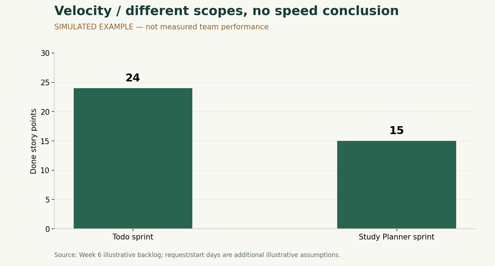

# Lab 7-2 — Velocity Analysis

ตามโจทย์หน้า 21–22: คำนวณเฉพาะ Story ที่ Done, มีกราฟ และวิเคราะห์ 8–12 บรรทัด

## 1. สูตรและตัวเลขตัวอย่าง

`Velocity = ผลรวม Story Point ของ Story ที่ผ่าน Definition of Done ภายใน Sprint`

ไม่นับ Story ที่ทำได้ 90%, ไม่คูณคะแนนด้วยเปอร์เซ็นต์ความคืบหน้า และไม่ย้ายวัน Done ให้เข้ากับ Sprint ที่ต้องการ งานข้าม Sprint ให้นับใน Sprint ที่ผ่าน DoD จริง โดยไม่ให้คะแนนซ้ำ

| Sprint ตัวอย่าง | Calculation | Velocity จำลอง | Not Done SP จำลอง | สิ่งที่ต้องระวัง |
|---|---|---:|---:|---|
| Todo | TD-01 ถึง TD-07: 3+3+5+5+3+3+2 | 24 | 0 | เป็นข้อมูลจำลอง ไม่ใช่ค่าจริง |
| Study Planner | SP-01 ถึง SP-05: 3+5+2+2+3 | 15 | 0 | เลือก scope 15 จาก Product Backlog 28 |

ตัวเลขต่างกัน `15 − 24 = −9 SP` หรือ `−9 ÷ 24 × 100 = −37.5%` เป็นเพียงความต่างเชิงคณิตศาสตร์ของชุดจำลอง **ไม่ใช่หลักฐานว่าประสิทธิภาพทีมลดลง 37.5%** จึงใช้กราฟแท่งแยกขอบเขต ไม่ลากเส้นเป็นแนวโน้มความเร็ว

SP-06 ถึง SP-08 ของ Study Planner อยู่นอก Sprint ที่เลือก จึงไม่ใช่ Not Done ของ Sprint นั้น และไม่นำ 13 คะแนน Future Backlog มารวมเป็นงานค้างของ Sprint

## 2. บทวิเคราะห์ 10 บรรทัด

1. ในสถานการณ์จำลอง Sprint Todo มี Velocity 24 SP ส่วน Study Planner มี 15 SP เพราะตัวอย่างกำหนดให้งานใน scope ผ่าน Done ครบ
2. ค่าลดลง 9 SP แต่สอง Sprint เป็นคนละผลิตภัณฑ์และมีขอบเขตต่างกัน จึงยังสรุปว่าทีมช้าลงไม่ได้
3. คะแนนทั้งสองชุดเป็นข้อเสนอ ไม่ได้มีหลักฐานว่าทีม Estimate ด้วยฐานเดียวกัน จึงไม่ควรนำมาเทียบประสิทธิภาพตรง ๆ
4. Not Done เท่ากับ 0 เฉพาะในตัวอย่าง ส่วนผลจริงยังไม่ทราบจนกว่าจะตรวจสถานะและหลักฐานตาม DoD
5. Story 5 SP เช่น TD-03, TD-04 และ SP-02 ควรตรวจว่ามีหลายเงื่อนไขรวมกันหรือไม่ เพราะอาจทำให้ปิดงานช้า
6. การมี tests ผ่านช่วยตรวจพฤติกรรมที่ทดสอบ แต่ยังไม่มีจำนวน bug ราย Sprint ให้สรุปว่าคุณภาพดีขึ้นหรือลดลง
7. ค่า Lead/Cycle ที่คำนวณได้ก็เป็นตัวอย่างเช่นกัน ใช้ฝึกตั้งคำถามเรื่องเวลารอได้ แต่ยังพิสูจน์ผลปรับปรุงทีมไม่ได้
8. ก่อนวางแผนรอบใหม่ควรเก็บข้อมูลจริงอย่างน้อยหนึ่ง Sprint ของงานลักษณะใกล้กัน และตรวจเวลาว่างของสมาชิก
9. สำหรับรอบ Study Planner ถัดไปเสนอพิจารณางานสำรองข้อมูลชุดเล็กประมาณ 5 SP หลัง Refinement และทีมยืนยัน Estimate ไม่ใช่รับ 15 หรือค่าเฉลี่ย 19.5 โดยอัตโนมัติ
10. เป้าหมายคือคาดการณ์งานได้ดีขึ้นด้วย Story ที่ชัด การจำกัดงานระหว่างทำ และการตรวจ DoD ไม่ใช่เพิ่ม Point ให้กราฟสูงขึ้น

## 3. คำตอบเรื่อง Capacity และความแม่นของ Estimate

ยังวัดความแม่นของ Estimate จริงไม่ได้ เพราะไม่มีคะแนนที่ทีมตกลงและผลจบจริง ถ้ามีเพียง Sprint เดียวให้รายงานค่านั้นพร้อมข้อจำกัด ไม่ต้องสร้าง Sprint ที่สองขึ้นเพื่อให้มี trend สองรายการในชุดนี้เป็นตัวอย่างคนละ scope ที่สืบต่อจาก Week 6 เท่านั้น

ข้อเสนอ 5 SP ในข้อ 9 มาจากงาน Export 1 + ตรวจไฟล์/Preview 2 + ยืนยันนำเข้า 2 ใน Lab 7-4 เป็นขอบเขตทดลองเพื่อหารือ ไม่ใช่ Capacity ที่คำนวณจาก Velocity จริง ต้องปิด Open Questions, ยืนยันคะแนน และเช็คเวลาว่างก่อนรับเข้า Sprint

## 4. กรณีฝึกเพิ่ม — ไม่นำไปแก้ประวัติ Week 6

หากสมมติ SP-05 (3 SP) ยังไม่ผ่าน DoD ณ D5 ขณะที่เรื่องอื่นผ่าน จะได้ Velocity `3+5+2+2 = 12 SP` และ Not Done `3 SP` ไม่ใช่ 15 หรือ 14.7 SP แม้เขียนโค้ดไปแล้วเกือบเสร็จ

กรณีนี้แสดงวิธีนับงานค้างแยกต่างหาก ไม่ใช่การเปลี่ยนตัวอย่างหลักย้อนหลัง ใน Excel สามารถลองเปลี่ยน Status ของ SP-05 เป็น Not Done และล้างวัน Done หรือใส่วันที่หลัง Sprint end แล้วสังเกตสูตร ก่อนเปลี่ยนกลับถ้าต้องการใช้ตัวอย่างหลัก
