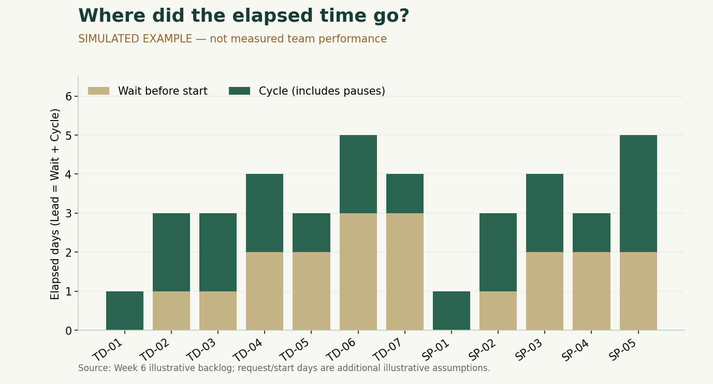

# Lab 7-3 — Lead Time & Cycle Time Analysis

ตามโจทย์หน้า 23–24 และ checklist หน้า 30: คำนวณอย่างน้อย 5 รายการ, ค่าเฉลี่ย, งานที่นานที่สุด, วิเคราะห์ Bottleneck และเสนอปรับปรุงอย่างน้อย 2 ข้อ

## 1. นิยามและวิธีนับ

- **Lead Time = Done − Request:** เวลาตั้งแต่รับคำขอจนส่งมอบ
- **Cycle Time = Done − Start:** เวลาที่ผ่านไปตั้งแต่เริ่มทำจนส่งมอบ รวมช่วงติด Blocker/รอ Review หลังเริ่มด้วย ไม่ใช่เวลานั่งเขียนโค้ดล้วน
- **Wait before start = Start − Request:** เวลารอก่อนเริ่ม ดังนั้น `Lead = Wait + Cycle`

นับวันแบบผลต่างตามตัวอย่างในสไลด์ เช่น D1→D2 = 1 วัน ไม่บวก 1 ถ้าใช้วันที่ปฏิทินจริงให้ใช้หน่วยเดียวกันทุกแถวและระบุว่าเป็น elapsed calendar days การเสร็จวันเดียวกันอาจได้ 0 วันเพราะความละเอียดเป็นรายวัน ไม่ได้หมายถึงไม่ได้ใช้เวลาเลย

## 2. ตารางคำนวณ — ทุกแถวเป็นข้อมูลจำลอง

| ID | Request | Start | Done | Lead (วัน) | Cycle (วัน) | Wait (วัน) |
|---|---|---|---|---:|---:|---:|
| TD-01 | D0 | D0 | D1 | 1 | 1 | 0 |
| TD-02 | D0 | D1 | D3 | 3 | 2 | 1 |
| TD-03 | D0 | D1 | D3 | 3 | 2 | 1 |
| TD-04 | D0 | D2 | D4 | 4 | 2 | 2 |
| TD-05 | D1 | D3 | D4 | 3 | 1 | 2 |
| TD-06 | D0 | D3 | D5 | 5 | 2 | 3 |
| TD-07 | D1 | D4 | D5 | 4 | 1 | 3 |
| SP-01 | D0 | D0 | D1 | 1 | 1 | 0 |
| SP-02 | D0 | D1 | D3 | 3 | 2 | 1 |
| SP-03 | D0 | D2 | D4 | 4 | 2 | 2 |
| SP-04 | D1 | D3 | D4 | 3 | 1 | 2 |
| SP-05 | D0 | D2 | D5 | 5 | 3 | 2 |

ตัวอย่าง TD-07: Lead = 5−1 = 4 วัน, Cycle = 5−4 = 1 วัน, Wait = 4−1 = 3 วัน งานใช้เวลารอก่อนเริ่ม 3 ใน 4 วันของ Lead จึงควรเริ่มตรวจที่คิวก่อนเริ่มงาน

## 3. ค่าเฉลี่ยแยก Sprint

| Sprint | จำนวน Done ที่มีวันครบ | Lead รวม / เฉลี่ย | Cycle รวม / เฉลี่ย | Wait รวม / เฉลี่ย |
|---|---:|---|---|---|
| Todo | 7 | 23 ÷ 7 = **3.29 วัน** | 11 ÷ 7 = **1.57 วัน** | 12 ÷ 7 = **1.71 วัน** |
| Study Planner | 5 | 16 ÷ 5 = **3.20 วัน** | 9 ÷ 5 = **1.80 วัน** | 7 ÷ 5 = **1.40 วัน** |

ใช้ค่าจริงก่อนปัดเศษในการคำนวณ ไม่บวกค่าเฉลี่ยที่ปัดแล้วเพื่อตรวจสมการ ไม่ถ่วงค่าเฉลี่ยเวลาด้วย Story Point เพราะโจทย์ต้องการค่าเฉลี่ยต่อ Story; ไม่รวมงาน Not Done ที่ไม่มีวันส่งมอบ และไม่แทนเวลาที่หายไปด้วย 0

## 4. งานนานที่สุดและ Bottleneck ที่ควรตรวจ

| สิ่งที่เห็นจากตัวอย่าง | สิ่งที่ควรถามทีม/หลักฐานเพิ่ม | ยังสรุปอะไรไม่ได้ |
|---|---|---|
| TD-06 และ SP-05 มี Lead สูงสุดร่วมกัน 5 วัน | งานเข้าคิวและผ่านขั้นตอนอะไรบ้าง; มี Blocker เมื่อใด | ใครทำงานช้า หรือสาเหตุจริงจากตัวเลขอย่างเดียว |
| TD-06/TD-07 รอก่อนเริ่มสูงสุด 3 วัน; TD-07 Cycle แค่ 1 วัน | Priority, dependency, WIP และวันอัปเดต Board | การลดเวลาเขียนโค้ดจะแก้การรอก่อนเริ่มได้แน่นอน |
| SP-05 มี Cycle สูงสุด 3 วัน | เวลาทดสอบ storage, รอ Review, แก้ bug, หรือ scope เปลี่ยน | ใช้เวลาเขียนโค้ดตลอด 3 วัน |
| Lead เฉลี่ยของ Study ต่ำกว่านิดเดียว แต่ Cycle สูงกว่า | ขนาดงานและขั้นตอนต่างกันอย่างไร | ทีมเร็วขึ้นจากค่าเฉลี่ย Lead เพียงตัวเดียว |

สาเหตุในคอลัมน์ Blocker ของ Lab 7-1 เป็นเรื่องสมมติไว้ฝึกวิเคราะห์ ในข้อมูลจริงต้องยืนยันด้วย Daily/Board/Review ก่อนกล่าวว่าเป็นคอขวดจริง

## 5. ข้อปรับปรุง Sprint ถัดไป

| Action | เชื่อมกับตัวเลขใด | วิธีทำ | Owner เสนอ | วิธีตรวจผล |
|---|---|---|---|---|
| W7-A1 ลดคิวก่อนเริ่ม | TD-06/07 Wait = 3 วัน | ทบทวน Priority และ dependency ก่อน Planning; เสนอ WIP ไม่เกิน 1 Story ต่อคน; Daily แจ้งงานที่รอคนอื่น | S1 ประสาน, ทุกคนร่วม | บันทึก Wait จริงทุก Story และเหตุผลที่รอ; เทียบกับ baseline จริงของงานใกล้กันใน Sprint ต่อไป |
| W7-A2 ลดความไม่ชัดหลังเริ่ม | SP-05 Cycle = 3 วัน | แบ่งงานสำรองข้อมูลเป็น Export/Preview/ยืนยันนำเข้า พร้อมกรณีผิดพลาด; ให้เพื่อนตรวจเป็นช่วงย่อย | S2 พัฒนา, S4 ตรวจ | ทุก Story ที่เริ่มมี AC; ระบุเวลารอ Review; ไม่มี Story Done ที่ขาดผลตรวจ |

ทั้งสองเป็นข้อเสนอให้ทีมตกลง ไม่ใช่ประกาศว่าทำสำเร็จแล้ว ไม่ตั้งเป้าลดเวลาเป็นเปอร์เซ็นต์จากข้อมูลจำลอง และไม่ตัดการทดสอบออกเพื่อทำให้ Cycle สั้นลง

## 6. กรณีข้อมูลไม่ครบ

งานยังไม่ Done ให้รายงาน “ยังคำนวณ Lead/Cycle แบบจบงานไม่ได้” และถ้าต้องการติดตามอายุงาน ให้แยกเป็น Work-item age ณ วันที่รายงาน ห้ามเรียกอายุงานว่า Cycle Time ที่ส่งมอบแล้ว ถ้า Request หายแต่ Start/Done มี อาจคำนวณ Cycle ได้ในรายงานแยกโดยบอก coverage; workbook ชุดนี้ใช้กติกาเข้มกว่าเพื่อเทียบคู่ Lead/Cycle จึงรอวันครบทั้งสามก่อนคำนวณแถวนั้น
